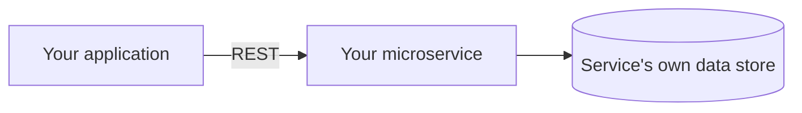

# Microservice

The microservice this group added, either as a new feature or in place of part
of the existing application. Diagrams here are Mermaid, like those in
[architecture.md](architecture.md). When the service changes the architecture,
update the *Layers* diagram there too, and record the choices under
*Decisions*.

## Design

<What the service does, why it is a good candidate for a microservice, and how
it is built: its components, its own data store (it cannot share the
application's database), and where it is hosted. Replace the example below.>



## API

<How to communicate with the service: its public base URL, then each endpoint
with its method, path, parameters, and responses. Give a `curl` command for
each that works against the running service.>

```
<curl commands>
```

## Characteristics

<How the service has each characteristic of microservices in Engineering
Software Products Table 6.1.>

## Data Consistency

<Whether the service needed a mechanism to keep its data consistent with the
rest of the application, and if so, how it works. If none was needed, say
why.>

## How It Is Called

<Where the application calls the service, whether the call is synchronous or
asynchronous, and how the call stays resilient: a timeout with retries, or a
circuit breaker.>
